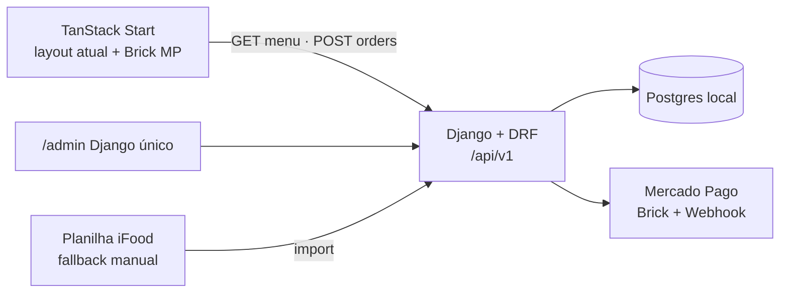
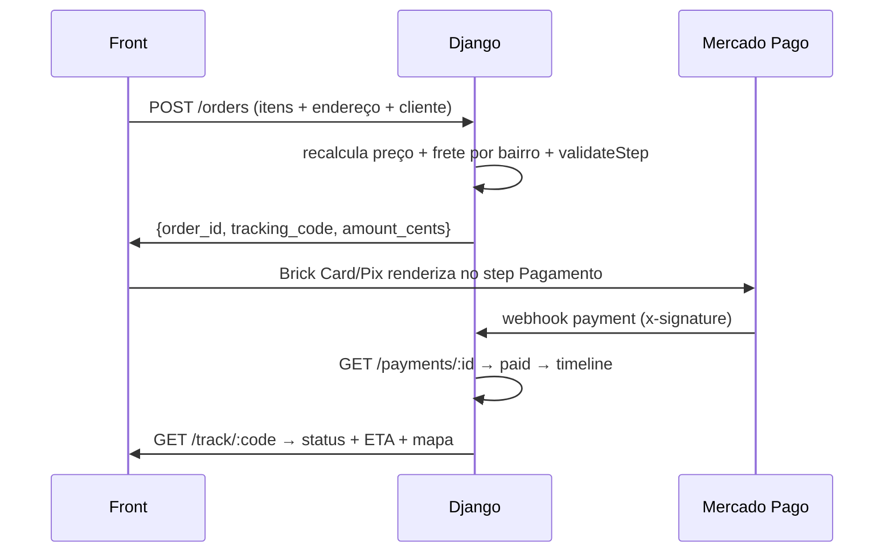

# BACKEND_PLAN — Ninha Cakes

> Plano de arquitetura do backend que roda **por debaixo** do cardápio.
> Documento de controle: qualquer mudança de decisão precisa ser registrada aqui
> (e em `docs/AGENTS.md`, que é o contexto canônico dos agentes).

## Decisões travadas

| # | Tema | Decisão | Alternativa descartada | Por quê |
|---|---|---|---|---|
| D1 | Framework | **Django 6 + DRF + drf-spectacular** | FastAPI + SQLAlchemy + SQLAdmin | Admin nativo (`/admin`) é o que viabiliza operar sem dev; ORM + `makemigrations` aceleram a evolução do modelo. A versão é 6 (não 5) porque `drf-spectacular 0.30` declara suporte até Django 6.0 — verificar `pyproject.toml` do módulo antes de fixar versão |
| D2 | Banco | **Postgres local** (Docker Compose, `postgres:16`) | SQLite em produção | UUID, concorrência de pedidos, `TEXT[]`, `JSONB`; e o alvo de evolução (gateway, painel) exige |
| D3 | Fonte do cardápio | **Postgres é a fonte da verdade**; `catalog.ts` vira seed/fallback | Cardápio estático no front | Admin precisa alterar cardápio sem deploy |
| D4 | Checkout | **Mercado Pago Brick embutido** (sem redirect) | Checkout Pro (`init_point`) / redirect por WhatsApp | Cliente paga dentro do cardápio, sem sair da experiência |
| D5 | Canal de confirmação | **WhatsApp vira notificação**, não checkout | WhatsApp como destino do pedido | Pedido precisa existir no banco antes de pagar |
| D6 | iFood | **Fase 1 = import manual** de planilha/export | API oficial imediata | Credenciais de parceiro + homologação não estão disponíveis agora; a API vira fase 2 sobre o mesmo normalizador |
| D7 | Rastreio | **`tracking_code` + `tracking_token`**, mapa com status e ETA | GPS real do entregador | Entregador não tem app; MVP é status + rota estimada |
| D8 | Frete | **Tabela de preços por bairro** (`delivery_zones`) definida pela loja | "A combinar" (texto) / taxa por km | Loja já opera por bairro; taxa por km exigiria roteirização |
| D9 | Preço | **`price_cents INT`** no banco | Float (como `catalog.ts`) | Float causa erro de centavo em subtotal/troco |
| D10 | Verdade do pagamento | **Webhook** validado + `GET /v1/payments/{id}` | `back_urls` do navegador | `back_urls` só redireciona; o cliente pode fechar a aba |

## 1. Escopo e premissas

* O **layout do checkout atual não muda**: etapas Entrega → Dados → Pagamento → Revisão → Enviado (`src/components/CheckoutSteps.tsx:32-34` `CHECKOUT_STEPS`). Só o comportamento do passo Pagamento passa a processar de verdade.
* Postgres local. O front (TanStack Start) lê `GET /api/v1/menu`; se a API cair, cai no estático (`src/lib/catalog.ts`) — o cardápio nunca fica em branco.
* Um único painel `/admin` cobre: cardápio, pedidos, entrega/rastreio, frete, conciliação iFood, dados da loja.
* O carrinho **continua local** (`localStorage ninha-cart-v1`) — o backend recebe o snapshot no `POST /orders` e recalcula tudo.

## 2. Arquitetura



Estrutura planejada (fase 1):

```
backend/
├── docker-compose.yml           # postgres:16 + volume
├── .env.example                 # só chaves, sem valores
├── manage.py
├── config/                      # settings, urls, wsgi/asgi
├── apps/
│   ├── catalog/                 # Category, Product, Variation, VariationOption
│   ├── orders/                  # Order, OrderItem, OrderItemSelection, OrderEvent
│   ├── payments/                # Payment, webhook MP, Brick
│   ├── delivery/                # DeliveryZone, cálculo de frete
│   ├── tracking/                # tracking_code/token, consulta pública
│   ├── ifood_sync/              # IfoodLink, IfoodSyncRun, import de planilha
│   └── store/                   # StoreSettings, PaymentMethod
├── lib/                         # pricing, freight, whatsapp (texto do buildOrderMessage)
├── scripts/
│   ├── seed_from_catalog.py     # importa src/lib/catalog.ts
│   └── import_ifood_sheet.py    # importa planilha iFood
└── static/products/             # fotos servidas pelo backend
```

Variáveis de ambiente (`backend/.env`, **nunca commitar** — `.gitignore`):

`DATABASE_URL`, `MP_PUBLIC_KEY`, `MP_ACCESS_TOKEN`, `MP_WEBHOOK_SECRET`, `FRONT_URL`, `ADMIN_USER`, `ADMIN_PASSWORD`, `NINHA_WHATSAPP`.

## 3. Fluxo de checkout (Brick embutido + rastreio)



1. **PaymentStep mantém os 4 métodos.** `pix` e `cartao-online` (`via_mp=true`) abrem o Brick dentro do próprio step. `dinheiro` e `cartao-entrega` seguem o fluxo atual e vão direto para `preparing`.
2. **O servidor nunca confia em preço do front.** `unit = price_cents + Σ price_delta_cents`; `amount = subtotal + delivery_fee`; é esse `amount` que vai ao Brick, com `external_reference = order_id` e `x-idempotency-key` derivado do `order_id`.
3. **Webhook é a verdade.** `POST /api/v1/webhooks/mercadopago` valida `x-signature` (SDK Python), responde `200` em menos de 22s, busca `GET /v1/payments/{id}`, faz upsert em `payments` com `mp_payment_id UNIQUE` (idempotência) e move `orders.status`.
4. **Pós-`paid`:** gera `tracking_code` (ex.: `NINHA-7X4K2Q`, único, ditável) + `tracking_token` (uuid, consulta pública sem login).
5. **Tela de rastreio** mostra código, status, ETA da zona e mapa (origem = loja, destino = bairro). GPS real do entregador é fase 2.

### Máquina de status

```
draft → awaiting_payment → paid → preparing → ready → out_for_delivery → delivered
  └──────────► failed (MP rejeita/expira)      └────► cancelled / refunded
```

* `dinheiro` / `cartao-entrega`: pulam `awaiting_payment` e vão direto a `preparing`.
* Toda transição grava linha em `order_events` (de → para, ator, horário). O front só conhece `draft|awaiting_payment|paid`; o painel admin opera o resto.

## 4. Modelo de dados

DDL completo em `docs/DATA_MODEL.md`. Resumo das 11 tabelas:

`categories`, `products`, `variations`, `variation_options`, `customers`, `orders`, `order_items`, `order_item_selections`, `payments`, `delivery_zones`, `order_events`, `store_settings`, `payment_methods`, `ifood_links`, `ifood_sync_runs`.

Campos futuros já previstos sem migração: `price_label` (sob consulta), `min_order_note`, `sold_out`, `featured`, `business_hours`, `map_origin_lat/lng`, `ifood_links` (para a fase 2 da API).

## 5. Frete por bairro

* Cadastro em `/admin` → `delivery_zones`: `name`, `neighborhoods[]`, `fee_cents`, `min_free_cents`, `eta_min`, `is_active`.
* Cálculo no `POST /orders`: normaliza `district` (minúsculo, sem acento) → procura zona ativa → `delivery_fee`. Se subtotal ≥ `min_free_cents`, frete zera.
* Bairro fora da tabela → erro `district_uncovered` com mensagem "ainda não entregamos aí — chame no WhatsApp" (o botão de WhatsApp já existe no front).
* `retirada` → taxa 0.
* **Pendência bloqueante:** a loja precisa enviar a tabela de bairros e valores. Hoje o código só diz "a combinar" (`src/lib/checkout.ts:117`).

## 6. iFood — fase 1 (import manual)

Formato aceito (CSV exportado do relatório do iFood):

```
ifood_item_id;name;description;price;status;image_url;category;external_code
```

Fluxo do `import_ifood_sheet.py`:

1. Normaliza: `slug` a partir do nome, `price` → `price_cents`, `status` → `sold_out`.
2. Dedupe em 3 níveis: `ifood_links` por `item_id` → `external_code` → slug/nome normalizado.
3. Classifica cada linha: `novo` · `igual` · `divergente`.
4. `divergente` **nunca sobrescreve sozinho** — entra na fila "Revisar" no admin com diff lado a lado (preço, foto, descrição) e os botões Aplicar / Manter local.
5. Grava tudo em `ifood_sync_runs` com o payload bruto, para auditoria.
6. Fotos são baixadas para `backend/static/products/`. Hoje 9 bebidas reusam a mesma `bebida.svg` (`src/lib/catalog.ts` `photo("bebida")`) — cada bebida ganha foto própria na revisão.

Fase 2 (quando houver credenciais): mesma lógica, só troca a fonte — `GET /catalogs` → `GET /categories?include_items=true` → `GET /catalogs/{groupId}/sellableItems`. A escrita de volta (`PUT /items` para pausar/preço no iFood) fica **desligada por padrão**.

## 7. Admin único — matriz

| Seção | O que o operador faz sem dev |
|---|---|
| Cardápio | CRUD categoria/produto/variação/opção, `sort_order`, destaque, esgotado, sob-consulta, upload de foto, pausar item |
| Pedidos | fila por status, timeline, reenviar Brick/WhatsApp, cancelar, reembolsar, ver pagamento MP |
| Entrega / rastreio | `preparing → ready → out_for_delivery → delivered`, ver zona/taxa/ETA, código de rastreio |
| Frete | CRUD de zonas e taxas, simular frete por bairro |
| iFood | importar planilha, fila de divergências, vínculo `ifood_links` |
| Loja | WhatsApp, endereço, horário, Instagram, origem do mapa |

Perfis: `operador` (pedidos + entrega) e `gerente` (tudo). Auditoria via `LogEntry` nativo do Django.

## 8. Endpoints

**Públicos (cacheáveis)**

* `GET /api/v1/store-settings`
* `GET /api/v1/menu` — categorias + produtos ativos ordenados, com variações/opções embutidas
* `GET /api/v1/products/{slug}`
* `GET /api/v1/payment-methods`
* `GET /api/v1/delivery-zones/simulate?district=`
* `GET /api/v1/track/{code}` — só status + ETA + dados de entrega. **Nunca** expõe telefone/completo/endereço do cliente
* `POST /api/v1/customers/upsert` — por telefone
* `POST /api/v1/orders` — cria `draft`, recalcula preço e frete
* `POST /api/v1/orders/{id}/brick-preference` — cria a preferência MP, devolve o Brick
* `POST /api/v1/webhooks/mercadopago`

**Admin (autenticado, DRF)**

* CRUD de `categories`, `products`, `variations`, `variation_options`, `delivery_zones`, `store_settings`, `payment_methods`
* `POST /api/v1/admin/ifood-import` · `GET /api/v1/admin/ifood-conflicts`
* `POST /api/v1/admin/orders/{id}/transition`

## 9. Fases de execução

| Fase | Entrega | Tempo estimado |
|---|---|---|
| 1 | Postgres + Django + modelos + `/admin` + `GET /menu` + seed dos 38 produtos de `catalog.ts` | 1–2 dias |
| 2 | Zonas de frete + cálculo + `tracking_code`/`token` + `GET /track/{code}` + tela de mapa | 2 dias |
| 3 | Brick MP no step de Pagamento + webhook + `ngrok` local + testes sandbox (aprovado/recusado/pendente) | 2–3 dias |
| 4 | Import manual iFood + fila de divergências | 1–2 dias |
| 5 | Corte do front: `GET /menu` com fallback estático, `cartao-online available:true`, treinamento do operador | 1 dia |

## 10. Riscos e pendências

**Bloqueantes (precisam de resposta da loja)**

1. **Tabela de frete por bairro** — sem ela a fase 2 não fecha.
2. **Horário de funcionamento** — o footer diz "Ter a Dom · 10h às 20h" (`src/routes/index.tsx:440`) e o código diz `h >= 14` (`src/routes/index.tsx:620-624`). Definir o valor real antes do seed de `store_settings`.
3. **Credenciais do Mercado Pago** — `MP_ACCESS_TOKEN` + `MP_PUBLIC_KEY` + domínio autorizado para o Brick. Local exige `ngrok` (o `notification_url` rejeita localhost).
4. **Conta iFood** — quem é o titular e se há credenciais de parceiro para a fase 2.

**Técnicos**

* Fotos: 31 arquivos em `src/assets/products/` precisam ir para `backend/static/products/` com nome por slug.
* Idempotência: `mp_payment_id UNIQUE` + `x-idempotency-key` por pedido. Sem isso, retry do MP cria pagamento duplicado.
* `notification_url` do MP precisa responder `200`/`201` em até 22s; as 3 tentativas são reenviadas a cada 15 min.
* Nada de segredo em commit: `backend/.env`, `security_config.json` e `opencode.json` seguem no `.gitignore`.
* `makemigrations` é a fonte da verdade do schema — o DDL em `docs/DATA_MODEL.md` é o desenho inicial, não um dump para aplicar à mão.

## 11. Mapeamento campo a campo (catálogo atual → banco)

| Fonte atual | Campo no banco | Nota |
|---|---|---|
| `Category.id` (slug) | `categories.slug` (CITEXT) | `sort_order` = índice do array em `catalog.ts` (preserva a numeração `01..05` do front) |
| `Category.label` / `eyebrow` | `categories.label` / `eyebrow` | — |
| `Product.id` (slug) | `products.slug` (CITEXT) | — |
| `Product.name` / `description` | `products.name` / `description` | — |
| `Product.price` (float BRL) | `products.price_cents` (int) | `21.99 → 2199` |
| `Product.priceLabel` | `products.price_label` | hoje nenhum produto usa; quando usa, o front manda direto pro WhatsApp (`ProductSheet.tsx:85-103`) |
| `Product.image` (`photo(slug)`) | `products.image_url` | vira `/static/products/{slug}.jpg` |
| `Product.tags` | `products.tags` (JSONB) | hoje só `"Queridinho"` |
| `Product.featured` | `products.featured` | `featuredProducts` no front passa a ser filtro do backend |
| `Product.soldOut` | `products.sold_out` | — |
| `Product.minOrderNote` | `products.min_order_note` | — |
| `Product.variations[].label` | `variations.label` | — |
| `variations[].options[]` | `variation_options` | `priceDelta → price_delta_cents`; seleção default = `sort_order` 0 |
| `CartLine` (localStorage) | **não persiste** | vira `order_items` no momento do pedido |
| `CheckoutDraft` | `orders.*` | `fulfillment, street, district, complement, notes` |
| `CheckoutDraft.payment` | `payments.method` | — |
| `CheckoutDraft.changeFor` | `orders.change_for_cents` | validação `parseMoney` portada para o servidor |
| `CustomerProfile` (localStorage) | `customers` | `phone` como chave única; migra `ninha-profile-v1` no primeiro checkout |
| `STORE_ADDRESS` / `STORE_WHATSAPP_NUMBER` | `store_settings` | WhatsApp valida `^\d{10,15}$` (`menu-data.ts:35-37`) |
| Horário do footer | `store_settings.business_hours` (JSONB) | resolve a contradição com `isBusinessOpen` |
| `PAYMENT_METHODS` | `payment_methods` | `available` e `via_mp` |
| `suggestProducts` (`cross-sell.ts`) | **algoritmo, não dado** | fica no front ou vira `GET /menu/suggestions`; não persiste |
| "Taxa de entrega: a combinar" | `delivery_zones` | vira dado editável |
