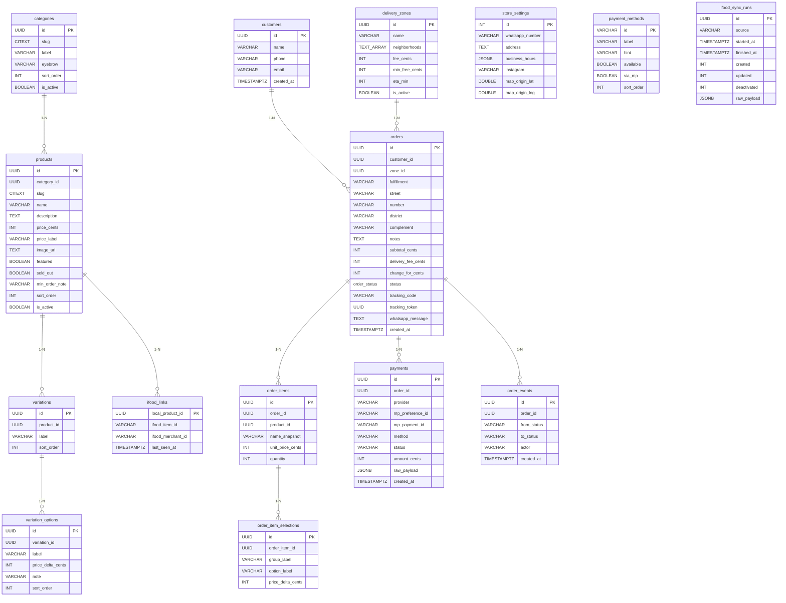

# DATA_MODEL — Ninha Cakes

> Desenho inicial do schema Postgres (fase 1). A fonte da verdade depois do
> bootstrap é o `makemigrations` do Django + `models.py`; este documento é o
> contrato de referência para revisão e para o ETL/seed.
> Decisões relacionadas: `docs/BACKEND_PLAN.md` §D2, §D9.

## Convenções

* PK: `UUID` (`uuid.uuid4`). **Divergência do desenho inicial:** o doc pedia
  `uuid.uuid7` para ordenação natural por criação, mas `uuid7` só existe no
  Python 3.14+ e o módulo roda em 3.12 (ver `pyproject.toml`). Nenhuma ordenação
  do schema depende da ordem natural da PK — todo sort é `sort_order` ou
  `created_at DESC` — então `uuid4` não custa nada. Se a ordenação natural virar
  requisito, bump do Python primeiro.
* Slugs: comparação **case-insensitive** — o front usa slug como id
  (`catalog.ts:22` `morango-cravejado`). **Divergência:** o DDL usava `CITEXT`,
  mas `CITextField` foi **removido no Django 6**. A via suportada é
  `TextField(db_collation="ninha_ci")`, com a collation ICU `und-u-ks-level2`
  (`deterministic=false`) criada em `catalog/migrations/0000_ninha_ci_collation.py`.
* Nomes de tabela: casam **exatamente** com o DDL abaixo via `Meta.db_table`
  (`products`, não `catalog_product`). O ETL do B10 usa SQL cru e depende disso.
* Dinheiro: **`_cents INT`**, nunca float. Motivo: `catalog.ts` usa `21.99` / `19.9`; subtotal e troco somam float e erram centavo. Os únicos `double precision` do schema são coordenadas (`map_origin_lat/lng`, `tracking_checkpoints.lat/lng`).
* `order_status`: **não** é `CREATE TYPE ... AS ENUM` nativo. É `TextChoices`
  (varchar + check). Enum nativo no Postgres exige `ALTER TYPE` para crescer e
  quebra o rollback de migração; a proteção contra valor errado é a mesma.
* Booleanos que o front já trata: `is_active` (some da listagem) vs `sold_out` (aparece com selo "Esgotado", `src/routes/index.tsx:539-543`).
* Ordenação visual: `sort_order` explícito, nunca ordenar por nome.

## Diagrama



Relações: `categories 1-N products`, `products 1-N variations`, `variations 1-N variation_options`,
`customers 1-N orders`, `delivery_zones 1-N orders`, `orders 1-N order_items`,
`order_items 1-N order_item_selections`, `orders 1-N payments`, `orders 1-N order_events`,
`products 1-1 ifood_links`. Detalhes e constraints no DDL abaixo.

## DDL

```sql
-- ── Catálogo ────────────────────────────────────────────────────────────────
CREATE TABLE categories (
  id          UUID PRIMARY KEY,
  slug        CITEXT UNIQUE NOT NULL,
  label       VARCHAR NOT NULL,
  eyebrow     VARCHAR NOT NULL DEFAULT '',
  sort_order  INT NOT NULL DEFAULT 0,
  is_active   BOOLEAN NOT NULL DEFAULT TRUE,
  created_at  TIMESTAMPTZ NOT NULL DEFAULT now()
);

CREATE TABLE products (
  id              UUID PRIMARY KEY,
  category_id     UUID NOT NULL REFERENCES categories(id) ON DELETE RESTRICT,
  slug            CITEXT UNIQUE NOT NULL,
  name            VARCHAR NOT NULL,
  description     TEXT NOT NULL DEFAULT '',
  price_cents     INT NOT NULL CHECK (price_cents >= 0),
  price_label     VARCHAR NULL,          -- "sob consulta": front manda pro WhatsApp
  image_url       TEXT NOT NULL,
  tags            JSONB NOT NULL DEFAULT '[]'::jsonb,
  featured        BOOLEAN NOT NULL DEFAULT FALSE,
  sold_out        BOOLEAN NOT NULL DEFAULT FALSE,
  min_order_note  VARCHAR NULL,
  sort_order      INT NOT NULL DEFAULT 0,
  is_active       BOOLEAN NOT NULL DEFAULT TRUE,
  created_at      TIMESTAMPTZ NOT NULL DEFAULT now(),
  updated_at      TIMESTAMPTZ NOT NULL DEFAULT now()
);
CREATE INDEX ON products (category_id, sort_order);
CREATE INDEX ON products (featured) WHERE featured AND is_active;

CREATE TABLE variations (
  id          UUID PRIMARY KEY,
  product_id  UUID NOT NULL REFERENCES products(id) ON DELETE CASCADE,
  label       VARCHAR NOT NULL,          -- "Tamanho", "Massa", "Cobertura"
  sort_order  INT NOT NULL DEFAULT 0
);

CREATE TABLE variation_options (
  id                 UUID PRIMARY KEY,
  variation_id       UUID NOT NULL REFERENCES variations(id) ON DELETE CASCADE,
  label              VARCHAR NOT NULL,
  price_delta_cents  INT NOT NULL DEFAULT 0,
  note               VARCHAR NULL,
  sort_order         INT NOT NULL DEFAULT 0,
  -- seleção default do front = primeiro option (ProductSheet.tsx:37-43)
  UNIQUE (variation_id, label)
);

-- ── Cliente ────────────────────────────────────────────────────────────────
CREATE TABLE customers (
  id          UUID PRIMARY KEY,
  name        VARCHAR NOT NULL,
  phone       VARCHAR UNIQUE NOT NULL,   -- chave natural (checkout.ts:68 isValidPhone)
  email       VARCHAR NULL,
  created_at  TIMESTAMPTZ NOT NULL DEFAULT now()
);

-- ── Frete ──────────────────────────────────────────────────────────────────
CREATE TABLE delivery_zones (
  id             UUID PRIMARY KEY,
  name           VARCHAR NOT NULL,       -- "Centro e adjacências"
  neighborhoods  TEXT[] NOT NULL,        -- match normalizado, minúsculo e sem acento
  fee_cents      INT NOT NULL CHECK (fee_cents >= 0),
  min_free_cents INT NULL,               -- subtotal >= X ⇒ frete 0
  eta_min        INT NULL,               -- usado na tela de rastreio
  is_active      BOOLEAN NOT NULL DEFAULT TRUE,
  created_at     TIMESTAMPTZ NOT NULL DEFAULT now()
);
CREATE INDEX ON delivery_zones USING GIN (neighborhoods);

-- ── Pedido ─────────────────────────────────────────────────────────────────
CREATE TYPE order_status AS ENUM (
  'draft','awaiting_payment','paid','preparing','ready',
  'out_for_delivery','delivered','cancelled','refunded','failed'
);

CREATE TABLE orders (
  id                UUID PRIMARY KEY,
  customer_id       UUID NULL REFERENCES customers(id) ON DELETE SET NULL,
  zone_id           UUID NULL REFERENCES delivery_zones(id) ON DELETE SET NULL,
  fulfillment       VARCHAR NOT NULL CHECK (fulfillment IN ('entrega','retirada')),
  street            VARCHAR NULL,
  number            VARCHAR NULL,
  district          VARCHAR NULL,
  complement        VARCHAR NULL,
  notes             TEXT NULL,
  subtotal_cents    INT NOT NULL,
  delivery_fee_cents INT NOT NULL DEFAULT 0,
  change_for_cents  INT NULL,
  status            order_status NOT NULL DEFAULT 'draft',
  tracking_code     VARCHAR UNIQUE NULL,   -- "NINHA-7X4K2Q"
  tracking_token    UUID UNIQUE NULL,      -- consulta pública sem login
  whatsapp_message  TEXT NULL,
  created_at        TIMESTAMPTZ NOT NULL DEFAULT now(),
  updated_at        TIMESTAMPTZ NOT NULL DEFAULT now()
);
CREATE INDEX ON orders (status, created_at DESC);
CREATE INDEX ON orders (tracking_code);

CREATE TABLE order_items (
  id                UUID PRIMARY KEY,
  order_id          UUID NOT NULL REFERENCES orders(id) ON DELETE CASCADE,
  product_id        UUID NULL REFERENCES products(id) ON DELETE SET NULL,
  name_snapshot     VARCHAR NOT NULL,     -- snapshot: produto pode renomear depois
  unit_price_cents  INT NOT NULL,
  quantity          INT NOT NULL CHECK (quantity >= 1)
);
CREATE INDEX ON order_items (order_id);

CREATE TABLE order_item_selections (
  id                 UUID PRIMARY KEY,
  order_item_id      UUID NOT NULL REFERENCES order_items(id) ON DELETE CASCADE,
  group_label        VARCHAR NOT NULL,
  option_label       VARCHAR NOT NULL,
  price_delta_cents  INT NOT NULL DEFAULT 0
);
CREATE INDEX ON order_item_selections (order_item_id);

CREATE TABLE order_events (
  id           UUID PRIMARY KEY,
  order_id     UUID NOT NULL REFERENCES orders(id) ON DELETE CASCADE,
  from_status  VARCHAR NULL,
  to_status    VARCHAR NOT NULL,
  actor        VARCHAR NOT NULL,          -- "webhook:mp" | "admin:gerente" | "sistema"
  created_at   TIMESTAMPTZ NOT NULL DEFAULT now()
);
CREATE INDEX ON order_events (order_id, created_at);

-- ── Pagamento ──────────────────────────────────────────────────────────────
CREATE TABLE payments (
  id                 UUID PRIMARY KEY,
  order_id           UUID NOT NULL REFERENCES orders(id) ON DELETE CASCADE,
  provider           VARCHAR NOT NULL DEFAULT 'mercadopago',
  mp_preference_id   VARCHAR NULL,
  mp_payment_id      VARCHAR NULL UNIQUE,   -- idempotência do webhook
  method             VARCHAR NULL,
  status             VARCHAR NOT NULL DEFAULT 'pending',
  amount_cents       INT NOT NULL,
  raw_payload        JSONB NULL,
  created_at         TIMESTAMPTZ NOT NULL DEFAULT now()
);
CREATE INDEX ON payments (order_id);

-- ── Configuração da loja ───────────────────────────────────────────────────
CREATE TABLE store_settings (
  id                INT PRIMARY KEY DEFAULT 1 CHECK (id = 1),  -- linha única
  whatsapp_number   VARCHAR NOT NULL,        -- validar ^\d{10,15}$
  address           TEXT NOT NULL,
  business_hours    JSONB NOT NULL DEFAULT '{"days":[2,3,4,5,6,0],"opens":"10:00","closes":"20:00"}'::jsonb,
  instagram         VARCHAR NULL,
  map_origin_lat    DOUBLE PRECISION NULL,
  map_origin_lng    DOUBLE PRECISION NULL
);

CREATE TABLE payment_methods (
  id         VARCHAR PRIMARY KEY,           -- 'pix' | 'cartao-online' | 'cartao-entrega' | 'dinheiro'
  label      VARCHAR NOT NULL,
  hint       VARCHAR NOT NULL,
  available  BOOLEAN NOT NULL DEFAULT TRUE,
  via_mp     BOOLEAN NOT NULL DEFAULT FALSE,
  sort_order INT NOT NULL DEFAULT 0
);

-- ── iFood ──────────────────────────────────────────────────────────────────
CREATE TABLE ifood_links (
  local_product_id   UUID PRIMARY KEY REFERENCES products(id) ON DELETE CASCADE,
  ifood_item_id      VARCHAR NOT NULL,
  ifood_merchant_id  VARCHAR NOT NULL DEFAULT 'manual',
  last_seen_at       TIMESTAMPTZ NULL,
  UNIQUE (ifood_merchant_id, ifood_item_id)
);

CREATE TABLE ifood_sync_runs (
  id           UUID PRIMARY KEY,
  source       VARCHAR NOT NULL DEFAULT 'manual_sheet',  -- 'manual_sheet' | 'ifood_api'
  started_at   TIMESTAMPTZ NOT NULL DEFAULT now(),
  finished_at  TIMESTAMPTZ NULL,
  created      INT NOT NULL DEFAULT 0,
  updated      INT NOT NULL DEFAULT 0,
  deactivated  INT NOT NULL DEFAULT 0,
  raw_payload  JSONB NULL
);
```

## Seed inicial

**`payment_methods`** — espelha `PAYMENT_METHODS` (`src/lib/checkout.ts:11-27`), com `cartao-online` ligado agora que há Brick:

| id | label | hint | available | via_mp |
|---|---|---|---|---|
| `pix` | Pix | A Ninha envia a chave na confirmação | ✅ | ✅ |
| `cartao-online` | Cartão online | Pagamento seguro no cardápio | ✅ | ✅ |
| `cartao-entrega` | Cartão na entrega | Crédito ou débito na maquininha | ✅ | ❌ |
| `dinheiro` | Dinheiro | Informe se precisa de troco | ✅ | ❌ |

**`store_settings`** — `whatsapp_number: '5521988073217'`, `address: 'Rua Tenente Luiz Meireles, 1100 — Bom Retiro, Teresópolis/RJ'`, `instagram: '@ninha__cakes'`. **`business_hours` depende da confirmação da loja** (ver risco 2 no `BACKEND_PLAN.md`).

**Catálogo** — `scripts/seed_from_catalog.py` lê `src/lib/catalog.ts` (5 categorias, 38 produtos) e insere com `sort_order` = índice do array. `price: 21.99 → price_cents: 2199` com `round` (nunca `int` direto: `8.15 → 815`, e `int(8.15*100)` daria 814). `image_url` vira `/media/products/{slug}.jpg` (ou `.svg` quando a foto é vetor, ex. `bebida.svg` dividido por 8 produtos) — as fotos são copiadas de `src/assets/products/` para `media/` e nunca commitadas. O script **falha alto** se um slug não tiver foto — o `photo()` do front já lança nesse caso (`catalog.ts:11`), e o seed não pode ser mais tolerante que isso. O front usa `import.meta.glob` (só existe no Vite), então o seed parseia o `.ts` como texto com verificação de que nenhum `id:` ficou para trás.

## Invariantes (fazer ilegível o estado errado no banco)

* `price_cents >= 0` em produtos e opções.
* `quantity >= 1` em `order_items`.
* `mp_payment_id UNIQUE` — retry do webhook não duplica pagamento.
* `order_items.product_id` e `orders.customer_id` são `NULL`-able de propósito: produto deletado ou cliente apagado não pode derrubar o histórico do pedido.
* `store_settings` só tem a linha `id = 1` (CHECK + `force_insert=False` no `save()`).
* `delivery_zones.neighborhoods` sempre normalizado (minúsculo, sem acento) — a normalização acontece na escrita, nunca na consulta.
* `status` só muda por transição gravada em `order_events`; o admin não edita o campo direto.
* `categories` não pode ser apagada com produtos ligados (`ON DELETE PROTECT`).

**Pendência para o B8:** nada impede que o mesmo bairro apareça em duas zonas
ativas. O DDL não proíbe e o `GinIndex` não resolve. Enquanto o B8 não definir a
resolução, o B8 tem que escolher deterministicamente (por `name`) qual zona vale,
ou subir um `ExclusionConstraint` com `btree_gist`. Decisão pendente.

## Tabela que não estava no DDL original

`tracking_checkpoints` (app `tracking`) — uma linha por etapa visível no mapa
Leaflet, com `status`, `label`, `lat`/`lng`, `route TEXT[]` (polyline) e `eta_at`.
O DDL original só tinha `order_events` para rastreio, que é trilha de auditoria
(interno do admin) e não serve para renderizar mapa.
